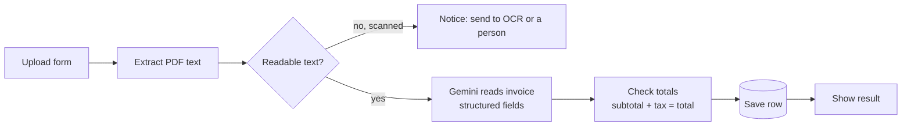

# 01 · AI Invoice Reader (PDF → clean data)

Upload a PDF invoice. The workflow reads the text, the AI pulls out the key fields, and the totals are checked before anything is saved.

**Fields extracted:** vendor, invoice number, invoice date, due date, currency, subtotal, tax, total, line items.

**Safety checks**
- If the number or total is missing, or `subtotal + tax ≠ total`, the row is saved with `needs_review = true` and a reason. It is never silently trusted.
- Scanned PDFs (no text layer) are not guessed. The user is told to use OCR or a person.

**Test run (sample invoice):** all fields correct in about 11 seconds.

**Client version ideas:** a Gmail trigger for invoice attachments instead of the form, and Google Sheets or Xero instead of the data table.

Nodes: Form Trigger · Extract from File · IF · Basic LLM Chain + Structured Output Parser · Gemini · Set · Data Table · Form completion
