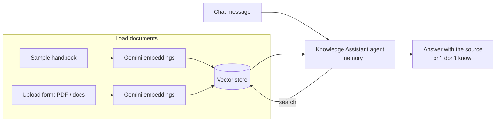

# 02 · AI Knowledge Assistant (RAG)

A chat assistant that answers questions **only from the company's own documents**, for example a staff handbook, FAQs or policies.

**How it behaves**
- It searches the documents first, then answers using only what it found.
- If the answer is not in the documents, it says so instead of guessing, and it can hand over to a person.
- Chat memory keeps the conversation short and on topic.

**Demo notes:** this uses n8n's simple in-memory vector store, so it is easy to try. A client version would use Supabase, Pinecone or Qdrant so the documents persist.

Nodes: Manual Trigger · Form Trigger · Default Data Loader · Gemini Embeddings · Vector Store (insert + retrieve as tool) · Chat Trigger · AI Agent · Gemini Chat Model · Window Buffer Memory
