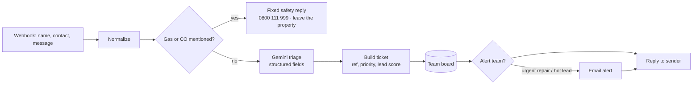

# 03 · Letting Agency Message Triage (repairs + renter leads)

The backend for a WhatsApp or website assistant at a letting agency. Every incoming message is sorted, answered and logged, and the team is alerted when it matters.

**The AI returns:** type (repair, renter lead or other), priority (urgent / normal / low), lead score 0–100, summary, property, next step, reply text and whether a human is needed.

**Safety by design**
- Gas and carbon monoxide messages **never go to the AI**. They get a fixed emergency reply straight away.
- Urgent repairs and hot leads alert the team by email. Everything is saved with a reference number.

Connect the webhook to WhatsApp Cloud API, Twilio or a website chat to use it with real messages.

Nodes: Webhook · Set · IF · Basic LLM Chain + Structured Output Parser · Gemini · Data Table · Gmail · Respond to Webhook
