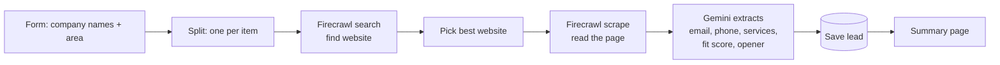

# 04 · AI Lead Finder (Firecrawl + AI)

Type in company names. The workflow finds each website, reads it, and returns real public contact details plus a fit score and a personal first line for outreach.

**Output per company:** website, email, phone, address, services, a yes/no service match, fit score 0–100, a personalised opening line, status and date found.

**Rules**
- Emails are **only copied from the website**, never guessed. If there is no public email, the lead is marked "No public email".
- Each lead is saved once.

A sample run on dental clinics in Manchester removed 53 directory and duplicate results out of 120, read 6 websites and kept 5 good fits with the reason saved.

Nodes: Form Trigger · Split Out · Firecrawl (search + scrape) · Basic LLM Chain + Structured Output Parser · Gemini · Set · Data Table · Form completion
