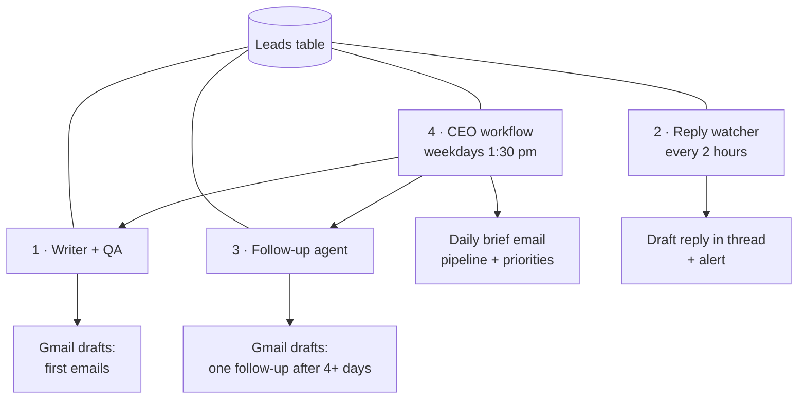

# 05 · AI Sales Team (4 connected workflows)

A small team of AI agents that handles cold outreach while a human stays in control. **Nothing is sent automatically**: every email is a Gmail draft that a person reviews and sends.

| File | Agent | What it does |
|---|---|---|
| `1-writer-qa.ts` | Writer + QA | Takes up to 10 leads ready to email, skips anyone already in Gmail Sent. A writer agent drafts a personal email, and a separate QA agent checks facts, length, tone and the opt-out line. Only emails that pass become drafts. |
| `2-reply-watcher.ts` | Reply watcher | Finds new replies from leads' domains. Classifies them as interested, meeting, question, not interested or auto reply, then drafts an answer in the same thread and alerts the owner. |
| `3-follow-up.ts` | Follow-up | Only if the first email was really sent 4+ days ago, with no reply and no follow-up yet: writes one short, polite follow-up as a draft. |
| `4-ceo-daily-brief.ts` | CEO | Runs the writer and follow-up workflows, reads the whole pipeline and emails a short daily brief with today's priorities. |

**Why two agents for writing:** the QA agent never rewrites. It only passes or fails a draft with a reason, so one agent can't approve its own mistakes.

Nodes: Schedule / Manual / Execute Workflow triggers · Data Table · Split in Batches · Gmail (search, draft, send to owner) · Basic LLM Chain + Structured Output Parsers · Gemini · OpenAI · Code
