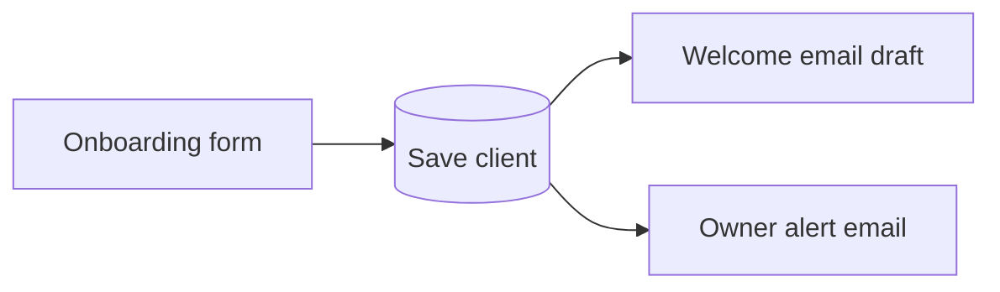

# 06 · Client Onboarding (form → setup)

When a new client signs up, they fill in one form with their business details. The workflow saves them, prepares a welcome email and alerts the owner, so no setup detail is lost in chat messages.

- The welcome email is a **draft**, so it can be checked before sending.
- `workflow.json` imports directly into n8n. Reconnect Gmail and choose your own data table after import.

Nodes: Form Trigger · Data Table · Gmail (draft) · Gmail (alert)
