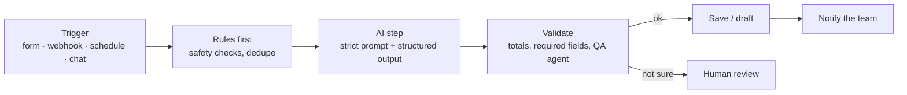

# n8n AI Automation Workflows

Six n8n workflows I built and tested with sample data: document reading, RAG, WhatsApp-style triage, lead research, a multi-agent sales team and client onboarding.

Each one follows the same rules: the AI gets strict instructions, humans approve anything that leaves the building, and nothing is guessed when data is missing.

> All of these are **demo builds with sample data**, not client projects. Company names, emails and documents in them are examples.

| # | Workflow | What it does | Main tools |
|---|---|---|---|
| 01 | [AI Invoice Reader](01-ai-invoice-reader) | PDF invoice → vendor, dates, line items, VAT, total → maths checked → saved, or flagged for review | Form, Extract from File, Gemini, Data Table |
| 02 | [AI Knowledge Assistant (RAG)](02-ai-knowledge-assistant-rag) | Chat that answers only from your own documents and says "I don't know" otherwise | Gemini embeddings, Vector Store, Chat Trigger |
| 03 | [Letting Agency Message Triage](03-letting-agency-whatsapp-triage) | Sorts tenant and renter messages: urgent repair, normal repair, hot lead. Gas/CO → fixed safety reply | Webhook, Gemini, Data Table, Gmail |
| 04 | [AI Lead Finder](04-ai-lead-finder) | Company names → finds the website → reads it → public contact details, fit score, personal first line | Firecrawl, Gemini, Data Table |
| 05 | [AI Sales Team (4 workflows)](05-ai-sales-team) | Writer + QA agents draft emails, reply watcher, follow-up agent, CEO agent sends a daily brief | Gmail, Gemini, OpenAI, sub-workflows |
| 06 | [Client Onboarding](06-client-onboarding) | Onboarding form → client saved → welcome email draft → owner alert | Form, Data Table, Gmail |

## How these are built

- **Structured output:** every AI step returns fixed fields through an output parser, never free text that the next node has to guess.
- **Human in the loop:** emails are created as Gmail **drafts**, never sent automatically. Risky or unclear cases go to a person.
- **Hard rules before AI:** for example, gas or carbon monoxide messages get a fixed safety reply without asking the AI.
- **No invented data:** emails and prices are only copied from real sources. Missing values are marked as missing.

## File format

- `workflow.json` files import directly into n8n: **Workflows → Import from File**.
- `*.ts` files are written with the **n8n Workflow SDK** (code-first n8n workflows in TypeScript). They can be built and pushed to n8n with the SDK or the n8n MCP server, and they are easy to read as plain code.
- Credential IDs, data table IDs and URLs are placeholders (`YOUR_CREDENTIAL_ID`, `YOUR_DATA_TABLE_ID`, `YOUR-N8N-URL`). Connect your own accounts after import.

## About me

I'm Ahmad Hassan, an n8n and AI agent developer from Lahore, Pakistan. I build AI receptionists, WhatsApp bots and business automations.

- Upwork: [n8n & AI Agent Developer](https://www.upwork.com/freelancers/~01309eb2dd70ae1da7)
- Fiverr: [aiautobuilder](https://www.fiverr.com/aiautobuilder)
- LinkedIn: [ahmadhassan-n8n](https://www.linkedin.com/in/ahmadhassan-n8n/)
